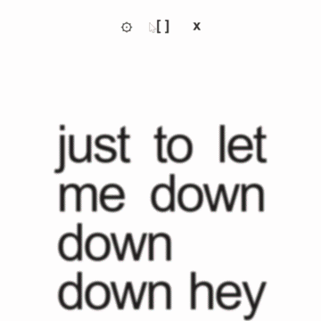
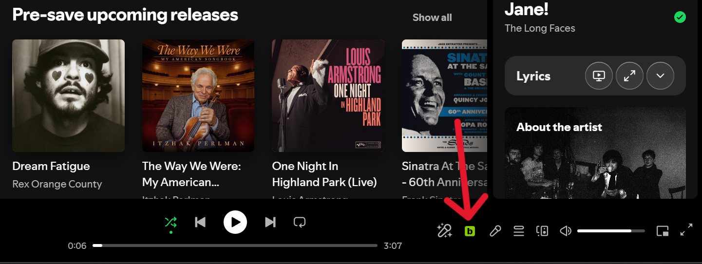

<p align="center">
  
</p>

# 🟩 Brat Lyrics for Spicetify (v2.0)

   

Bring the iconic, chaotic, and viral **"Brat" lyric edit** aesthetic straight to your Spotify Desktop.

Instead of regular boring lyrics, **Brat Lyrics v2.0** transforms your currently playing song into a dynamic, word-by-word, auto-squaring lowercase text block with real-time beat color flips—just like viral TikTok/Reels Brat edits.


##  What's New in v2.0
- **Word-by-Word / Syllable Tracking:** Lyrics now pop in word-by-word in sync with the vocalist using multi-source TTML & syllable pipelines.
- **3 Display Modes:**
  - **Word by Word (Auto-Zoom):** Words accumulate one by one while dynamically resizing the square block.
  - **Word by Word (Locked Box):** Locks the square geometry first and reveals words smoothly in place.
  - **Full Sentence (Instant Square):** Classic v1.0 mode—instantly renders the full sentence as an edge-to-edge square block.
- **Auto Color Flip (Viral Edit Style):** Automatically inverts the background and text colors (e.g., White/Black ↔ Black/White) randomly every **1–3 lines** or on **every single line**.
- **Customizable Transition Styles:** Choose between **Rigid (Classic Instant)**, **Smooth Fade**, or **Kinetic Slide Up**.
- **Real-time Sync Offset Calibration:** Fine-tune lyric timing on the fly (`-50ms` / `+50ms`) to match Bluetooth headphones or external speakers.
- **Playbar Integration & Shortcut:** Dedicated **`[b]`** button right in your bottom-right Playbar extra controls + quick **`Alt + B`** keyboard shortcut.



##  How to Use
1. Play any song on Spotify.
2. Click the green **`[b]`** icon located in the **bottom-right Playbar** (next to the native microphone/lyrics icon), or press **`Alt + B`** on your keyboard.
3. Hover over the top-center of the screen and click the **⚙ (Gear)** icon to customize Display Mode, Transition Style, Auto Color Flip, Theme Presets, and Sync Offset!
4. Press **`Esc`** or click **`✕`** to exit.



## 📥 How to Install

### 1. Using the Spicetify Marketplace (Recommended)
1. Open Spotify and go to the **Marketplace** tab (Shopping cart icon).
2. Click on the **Extensions** tab.
3. Search for **Brat Lyrics**.
4. Click the install button, play a song, and click the **`[b]`** button in your bottom-right Playbar!

### 2. Manual Installation (For Developers)
1. Make sure you have [Spicetify](https://spicetify.app/) installed.
2. Download the `brat-lyric.js` file from this repository.
3. Place `brat-lyric.js` inside your Spicetify `Extensions` directory (run `spicetify path userdata` to find it).
4. Open your terminal / PowerShell and run:
   ```powershell
   spicetify config extensions brat-lyric.js
   spicetify apply
   ```

## 🙏 Credits & Acknowledgments
- Inspired by the viral Brat album aesthetic by Charli XCX.
- Core lyric synchronization, parsing logic, and architectural inspiration respectfully credit the following developers and projects:
  - **[4argon](https://github.com/4argon)** - For foundational logic and parsing contributions.
  - **[Spicy Lyrics](https://github.com/spikerko/SpicyLyrics)** by spikerko - Multi-provider fallback and parsing logic (Licensed under [MIT](https://choosealicense.com/licenses/mit/)).
  - **[LyricsPlus / YouLy+](https://github.com/spicetify/spicetify-extensions/tree/master/lyrics-plus)** (prjktla) & **[LRCLIB](https://lrclib.net/)**.

##  License
This project is open-source and available under the [MIT License](https://choosealicense.com/licenses/mit/).
